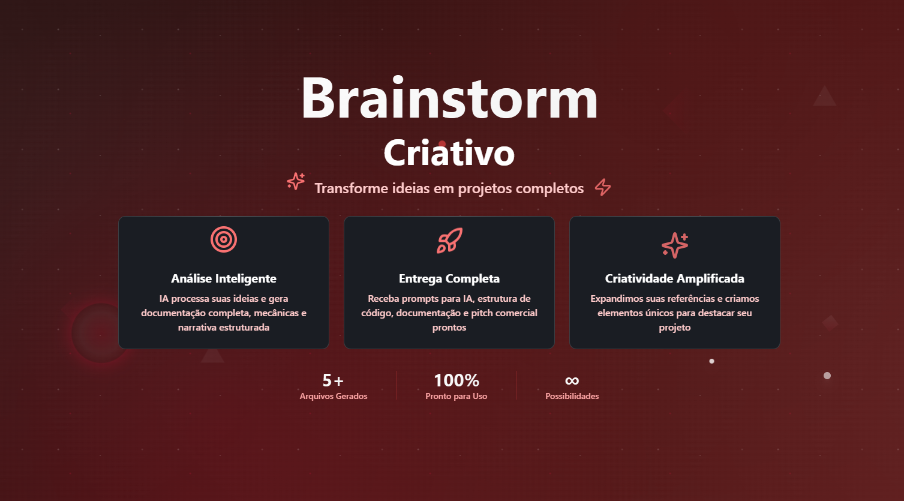

# 🧠 IdeaForge Nexus - Gênesis Criativa
<p align="center">
  <!-- Contador de linguagens -->
  
  <!-- Tamanho do repositório -->
  
  <!-- Licença -->
  
</p>

<div align="center">
  
</div>

## 📋 Sobre o Projeto
O **IdeaForge Nexus** é um agente criativo de geração de projetos, construído com foco em **design de jogos, storytelling e prototipagem inteligente**. A partir de uma ideia inicial, a IA transforma dados soltos em um pacote completo de produção, contendo documentação técnica, narrativa, prompts visuais e estrutura de pastas para engines como Unity ou Godot.

Este projeto une a potência do **Lovable** com modelos generativos para entregar **resultados prontos para uso em minutos**.

## ⚙️ Funcionalidades Principais
* 🧠 Geração automática de documentação narrativa e técnica
* 🖼 Criação de prompts para IA de imagem (Midjourney, Leonardo, DALL-E)
* 📂 Estrutura de pastas pronta para engines de desenvolvimento
* 🎮 Planejamento de gameplay e sistema de progressão
* 🧾 Pitch comercial para divulgação do projeto
* 📊 Avaliação de complexidade e versões simplificadas

## 🛠 Tecnologias Utilizadas
* **Lovable** (IDE AI-driven com deploy instantâneo)
* **React + TypeScript**
* **Tailwind CSS**
* **shadcn/ui**
* **Vite**

## 📂 Estrutura do Projeto
```
├── src/
│   ├── components/             # Componentes reutilizáveis
│   ├── pages/                  # Interfaces principais
│   ├── styles/                 # Estilização global
│   ├── prompts/                # Modelos prontos de prompt IA
│   └── data/                   # Arquivos gerados para entrega
├── public/                     # Recursos públicos
├── vite.config.ts              # Configuração do Vite
└── README.md                   # Documentação do projeto
````

## 🧭 Guia de Implementação
### 🔹 Usando o Lovable (recomendado)
1. Acesse o projeto em [Lovable](https://ideaforge-nexus-genesis.lovable.app)
2. Use prompts para refinar seu agente criativo
3. Publique via **Share > Publish**

### 🔹 Localmente com VSCode
```bash
git clone <URL_DO_REPOSITÓRIO>
cd ideaforge-nexus
npm install
npm run dev
````

## 🧠 Como Funciona no n8n
* O usuário preenche um formulário inicial com a ideia
* O front-end exibe os resultados com navegação intuitiva
* Os dados são enviados via Webhook ao n8n
* A IA processa e gera múltiplos arquivos:

  * Narrativa e lore
  * Personagens
  * Estrutura de gameplay
  * Prompts visuais e técnicos
  * Documento de pitch comercial

## 📦 Arquivos Gerados
* `documentacao.txt` - Visão geral + mapa mental + narrativa
* `prompts-imagem.txt` - Prompts para gerar artes no Midjourney/Leonardo
* `prompts-tecnicos.txt` - Estrutura para GPT/Gemini
* `estrutura-pastas.md` - Organização para engines como Unity/Godot
* `pitch-comercial.txt` - Texto para divulgação e investidores

## 💡 Exemplo de Uso
Imagine que você tenha apenas uma ideia vaga como:

> “Um viajante preso em sonhos lúcidos precisa resolver quebra-cabeças para escapar de mundos surreais”

O **IdeaForge Nexus** transforma isso em:  
✅ Narrativa com protagonista instável, oscilando entre real e onírico  
✅ Gameplay baseado em puzzles mentais, manipulação de tempo e percepção  
✅ Estética visual inspirada em *Dalí* e *Paprika*  
✅ Prompt para imagem: *“dreamlike city melting into itself with floating clocks and staircases that loop”*  
✅ Pitch: *“Uma experiência narrativa imersiva com puzzles psicodélicos — mistura de ‘Inside’ com ‘The Eternal Castle’”*

## 💪 Como Contribuir
1. Faça um fork deste repositório
2. Crie uma branch: `git checkout -b feature/nova-funcionalidade`
3. Commit: `git commit -m 'feat: adiciona nova entrega ao pipeline'`
4. Push: `git push origin feature/nova-funcionalidade`
5. Abra um Pull Request

## 📝 Nota
Este projeto nasceu como uma ferramenta para **prototipagem acelerada**, focado em criadores, devs solo e entusiastas de narrativas interativas. Combinando IA, automação e design centrado na criatividade, o **IdeaForge Nexus** é seu ponto de partida para transformar ideias em realidades jogáveis.

<br>

---

<p align="center">
  Desenvolvido com ☕ por <a href="https://github.com/seuUsuario">Ricardo Andreotti Gonçalves</a> 🧑‍💻
</p>
